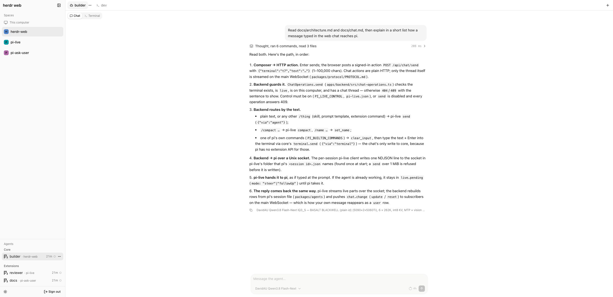

# herdr-web

A self-hosted web app for [herdr-core](https://herdr.dev/core/): your terminals and coding agents in the browser, with a chat view for pi.



herdr-web runs on the same machine as a herdr-core server. It mirrors core's spaces, tabs and terminals live, opens any terminal in the browser, and, for a [pi](https://github.com/earendil-works/pi) agent with pi-live loaded, shows the conversation as a chat you can read and write to.

It is built for one user: one passphrase, and a backend that listens only on `127.0.0.1`.

## Features

- **Live overview.** Spaces grouped by machine, tabs and panes as core lays them out, and an agents sidebar that shows which agents are working, done or unread.
- **Terminals in the browser.** A full terminal (xterm.js, WebGL) that follows the pane's size and reconnects by itself.
- **Terminal control.** Start a shell, pi or one of core's templates, kill a terminal, pin an agent, mark it unread.
- **Chat with pi.** Replies stream in as they are written, and tool calls and thinking fold into one line. You can stop a reply, switch model and effort, run slash commands, and page through old history.
- **Seen tracking.** An agent's turn is marked seen when you read it, in the chat or the terminal.
- Light and dark themes.

## Requirements

- macOS or Linux.
- [herdr-core](https://herdr.dev/core/) running on the same machine (tested with 0.1.21).
- Node 24 and pnpm.
- For chat: pi with [pi-ask-user](https://github.com/Trex-Hub/pi-ask-user), which brings pi-live 0.2 or later.

## Quick start

```sh
git clone https://github.com/Trex-Hub/herdr-web.git
cd herdr-web
pnpm install
pnpm build
HERDR_WEB_PASSPHRASE='choose-a-passphrase' pnpm backend start   # backend on 127.0.0.1:7420
pnpm web start                                                 # web app on localhost:3000
```

Open <http://localhost:3000> and sign in with the passphrase. The backend finds core's socket by itself. To run against another core, use another port, or open the app from another address, see [docs/configuration.md](docs/configuration.md).

## Trying chat

Chat comes from pi-live, the extension inside pi-ask-user.

1. Install it: `pi install git:github.com/Trex-Hub/pi-ask-user`.
2. Restart any pi that is already running. Extensions load at start-up.
3. Select the agent in herdr-web. Its pane now has a Chat / Terminal toggle.

The pi must run in a terminal of the core the backend is connected to. [docs/chat.md](docs/chat.md) covers the rest: what the chat can do, which commands go where, and turning control off.

## Documentation

| Read | For |
| --- | --- |
| [docs/using.md](docs/using.md) | The shell, terminal operations, seen, and the terminal view |
| [docs/chat.md](docs/chat.md) | Setting up and using the chat view |
| [docs/configuration.md](docs/configuration.md) | Every setting, and how the backend finds core and pi-live |
| [docs/architecture.md](docs/architecture.md) | How the pieces fit, and why they are shaped this way |
| [docs/development.md](docs/development.md) | Repository layout, tests, and the scratch core |
| [packages/protocol/PROTOCOL.md](packages/protocol/PROTOCOL.md) | The protocol between the browser and the backend |
| [packages/agents/README.md](packages/agents/README.md) | How chat rows are built from pi's session, and the pi-live client |

## Status

Early and in active development. The author uses it daily. There are no releases yet, and anything on `main` may change.

## Contributing

Issues and pull requests are welcome. Start with [docs/development.md](docs/development.md). Coding agents working in this repository should read [AGENTS.md](AGENTS.md).

## License

[MIT](LICENSE)
