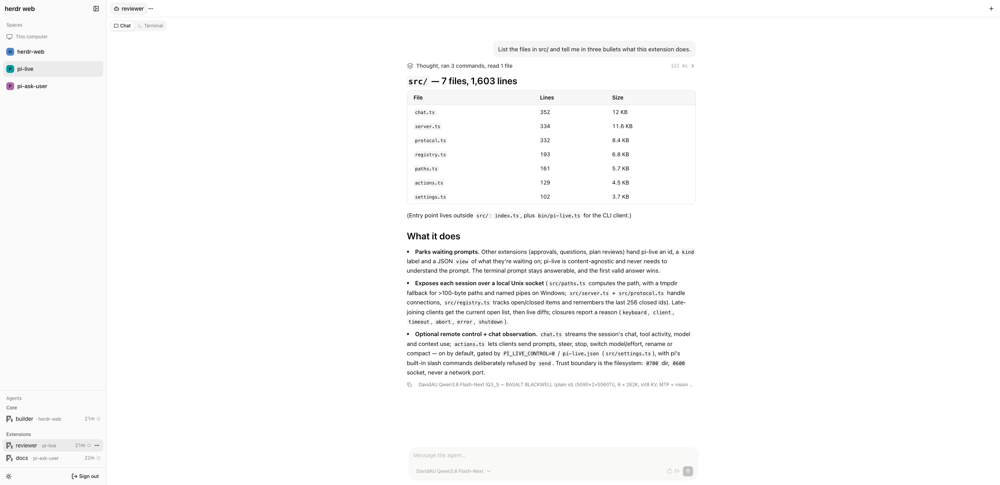

# Chat

A pi agent with [pi-live](https://github.com/Trex-Hub/pi-live) loaded gets a chat view in its pane, next to the terminal. pi-ask-user bundles pi-live, so a pi with [pi-ask-user](https://github.com/Trex-Hub/pi-ask-user) has it too.

## Set up

1. Install pi-live 0.2 or later: `pi install git:github.com/Trex-Hub/pi-live`. If you use pi-ask-user, update it instead (`pi update`), because it already includes pi-live. Questions in the chat need the Trex-Hub fork of pi-ask-user (a plain pi-ask-user asks in the terminal only). To try it for one run without installing, start pi with `pi -e git:github.com/Trex-Hub/pi-live`.
2. Restart any pi that is already running. Extensions load at start-up.
3. Run pi interactively, in a terminal of the core the backend is connected to.

`/new`, `/resume`, `/fork` and `/reload` keep the chat, which follows pi into the new session.

A pi is linked to its terminal only if all of these hold:

- pi-live names the terminal. It reads `HC_TERMINAL_ID`, which core sets in every terminal.
- pi is interactive. `pi -p`, JSON and RPC runs, such as a sub-agent started from inside a pi, are never linked.
- The terminal is live, on this computer, in the backend's core.
- pi-live and the backend use the same folder ([configuration](configuration.md#which-pi-live-folder)).

### Control

The backend connects as a chat client named `herdr-web`. With control off, the chat still shows but nothing can be sent. To turn it off for a pi, set `PI_LIVE_CONTROL=0`, or put `{ "control": false }` in `pi-live.json`.

Your own pis accept control from any program running as you, so treat pi-live's folder as private.

## In the pane

A terminal with a chat shows a **Chat / Terminal** toggle. Chat is the default, and the browser remembers your choice per terminal. Only the shown side is live: the chat subscribes while Chat is shown, and the terminal attaches while Terminal is shown.

When a pane has no chat, or can't send, it shows one line saying why:

| Line | Meaning |
| --- | --- |
| "Chat needs pi-live 0.2 or later…" | The terminal runs pi but has no chat. It shows above the terminal, and you can dismiss it. |
| "Update pi-live to chat with this pi." | That pi-live cannot chat. The rows show, and the composer is off. |
| "Control is off for this pi." | The rows show, and the composer is off. |
| "pi-live is not connected to this agent, so nothing can be sent" | pi went away. The last rows stay, dimmed, until it comes back. |

## The thread

- **Your messages** are bubbles on the right. The agent's replies are markdown, with highlighted code blocks you can copy.
- **Thinking** shows as "Thought" and opens to its text.
- **Tool calls** take one line each: name, main argument, duration and outcome. A line opens to the call and its result.
- **Runs of tool calls and thinking** collapse into one line, such as "Thought, ran 5 commands, read 1 file". The run the agent is working on stays open until the turn ends.
- **Compactions** and **model switches** show as dividers. Notices are quiet lines.
- **Under each reply** are a copy button and the model and effort it was written with.
- **Scrolling.** The thread follows new text until you scroll up. **Jump to latest** brings it back. Older history loads as you near the top.

## Questions from the agent

When pi asks you something with [pi-ask-user](https://github.com/Trex-Hub/pi-ask-user) (its `ask_user` tool, the Trex-Hub fork that parks each prompt on pi-live), the composer gives way to a panel, and the thread shows the question as one line.

- **The panel** takes the composer's place until the question is answered or closed. With several waiting, the oldest shows first and "1 more question waiting" says so. **Stop** stays in the panel.
- **Choices** are one list, each with its number. Pressing a number picks that row. A single choice without a comment is sent as soon as you pick; with several choices you tick rows and press **Submit**.
- **Type something else…** is the last row when the question allows free text. Typing there replaces any pick, and Enter sends it.
- **A comment** is an optional line under the choices when the question allows one.
- **Several questions at once** show one at a time, with **n/N** at the right, **Previous**, **Skip** and **Next**. Picking an answer moves on to the next question, and the last one waits for **Submit**. One answer goes to pi at the end, with the skipped questions marked.
- **A long context** shows its first lines, with **Show more**.
- If pi refuses an answer, its reason shows under the choices and the panel stays. If the question was already answered or closed (at the keyboard, in another window), the panel says so and goes.

The line in the thread follows the question: "Awaiting input…" while it is open (with "· expires in 2 min" when it has a deadline), "Answered" for the moment between sending and pi's reply, then **"Asked: … · Answered: …"**, which opens to every question and answer. A question that was cancelled, timed out or cut off by Stop reads "Not answered"; one that pi went away in the middle of reads "Stopped".

A prompt that pi-live does not hold (a pi with no pi-ask-user, or an old one) shows a read-only card with the question, its options and "Answer in the terminal." You answer it in the terminal; the line still ends with the answer.

## The composer

- Enter sends. Shift+Enter starts a new line.
- A draft is kept per terminal.
- While the agent works, a **Stop** button shows, and a message you send waits as pending until the agent takes it.
- Model and effort pickers switch pi's model and thinking level.

### Slash commands

| You type | What happens |
| --- | --- |
| `/compact [instructions]`, `/name <name>` | Sent to pi as actions. |
| A skill, a prompt template, or an extension's command | Sent to pi as a message, which pi runs. |
| One of pi's own commands (`/new`, `/resume`, `/model`, `/settings`, `/reload`, `/quit`, …) | Typed into the terminal. pi runs it a few seconds later, and the composer offers **Show terminal**. Commands that open a picker in pi switch the pane to Terminal. |

Some of pi's own commands have no extension API at all (`/login`, `/settings`, `/share`, `/export` and others), so the terminal is the only way to run them.
